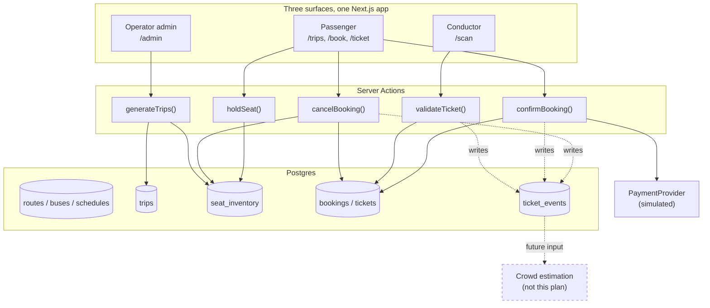
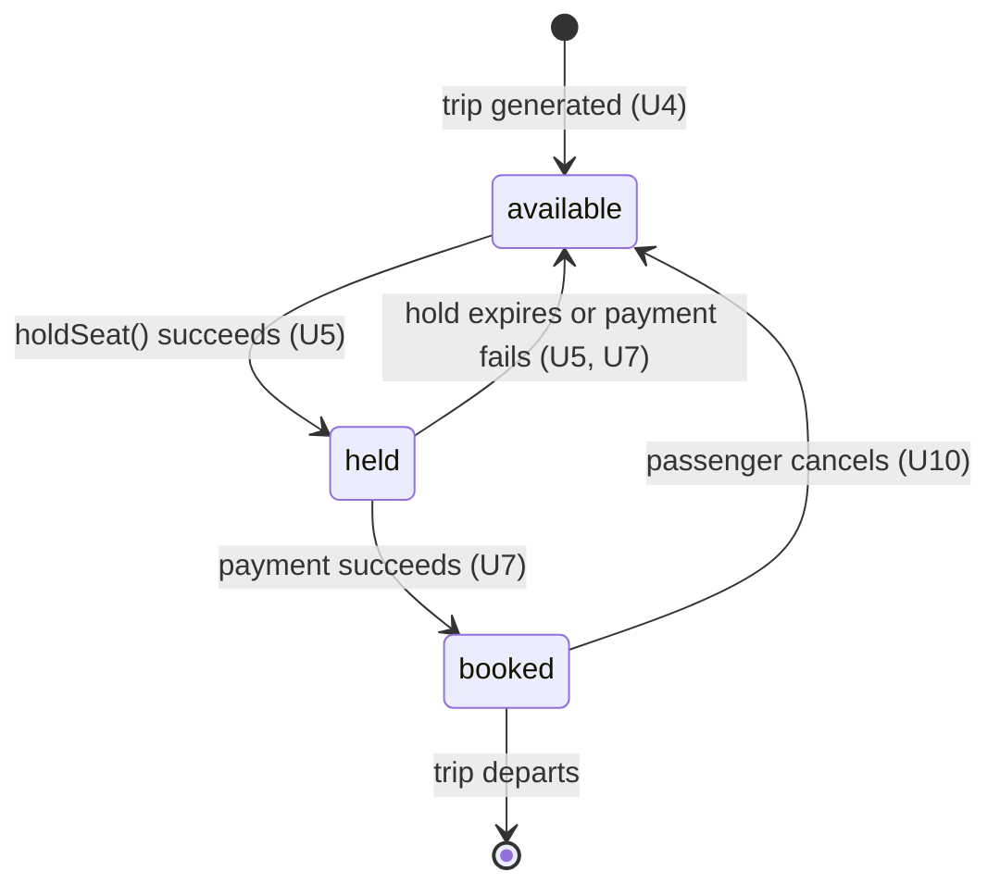

# QR Bus Ticketing and Payment - Plan

## Goal Capsule

**Objective:** A passenger can find a bus trip, reserve a specific seat, pay, and board by having a QR ticket scanned — and the operator can trust that each ticket admits exactly one person, once.

**Means:** A single Next.js application over Postgres, with seat integrity enforced in the database and QR tickets carried as signed opaque tokens (KTD1, KTD2, KTD3).

**Authority hierarchy:** The Product Contract wins on product behavior. The Planning Contract wins on implementation mechanism within the requirements it cites. A conflict between them stops the unit and is raised, not resolved in code.

**Stop conditions:** Stop and raise if seat integrity cannot be proven under concurrent booking of the same seat (U5), or if a validated ticket can be replayed (U8). These are the two correctness properties the prototype exists to demonstrate.

**Execution profile:** Greenfield. No existing code, tests, or conventions to preserve. Units land in dependency order; U1 through U5 are prerequisites for every later unit.

**Product authority:** This plan owns the ticketing and boarding-validation product only. Passenger crowd estimation is a separate, independently plannable product and is not active scope here; this plan's boarding-event record is designed as its future input.

**Open blockers:** None. Every requirement below is decided; the remaining questions are deferred to implementation.

---

## Product Contract

### Summary

A web application where a passenger browses an operator-defined route schedule, selects a seat on a specific trip, completes a simulated payment, and receives a QR ticket. A conductor opens a browser-based scanner on their phone and scans the QR at boarding, getting a single-use pass or fail verdict. Each validated scan is recorded as a boarding event.

### Problem Frame

Paper and cash bus ticketing puts every failure at the vehicle door. Passengers queue to buy from the conductor while the bus idles; the conductor handles cash and makes change under time pressure; a passenger who paid has no durable proof beyond a printed stub that cannot be checked against anything. The operator learns how full a bus was only from a day-end cash count, which reflects fares collected, not people carried — a passenger who travelled unticketed and a passenger who boarded a different trip than they paid for are both invisible.

The cost compounds. Because there is no trip-level record of who boarded, the operator cannot answer whether a service is over- or under-provisioned, and cannot tell a passenger before they leave home whether the 8am will have room. Every improvement to that depends on a reliable per-trip boarding record that does not exist today, and cannot be retrofitted onto cash.

### Key Decisions

- **Simulated payment behind a swappable interface.** (session-settled: user-directed — chosen over a real gateway sandbox: the full journey can be demonstrated without merchant onboarding, and a real gateway drops in later without reshaping the booking flow.) Governs R8, R9.
- **Reserved seats on specific trips.** (session-settled: user-directed — chosen over unreserved fares: more inventory machinery now, but occupancy becomes exact rather than estimated, which gives the downstream crowd product clean ground truth.) Governs R4, R5, R6.
- **Browser-based conductor scanner, no native app.** (session-settled: user-directed — chosen over a native Android scanner and over visual-only inspection: no install, works on any conductor phone, shares one codebase, and still produces real validation events.) Governs R12, R13.
- **Online-only validation with an explicit unverifiable state.** (session-settled: user-directed — chosen over offline signed verification with a sync queue: a scanner that cannot reach the server reports that plainly rather than guessing, and offline verification could not detect reuse before sync anyway.) Governs R15.
- **No passenger accounts.** (session-settled: user-approved — chosen over passenger sign-up with per-user booking quotas: removes auth from prototype scope; bookings are retrieved by reference code and the QR token is the credential.) Governs R10, R19.
- **Routes and schedules are operator-defined; trips are generated from them.** A route plus a weekly schedule produces dated trip instances, each owning its own seat inventory. A flat list of standalone trips would be faster to build but has no concept of the same service recurring, which is the grouping the crowd product must learn from. Governs R1, R2, R3.
- **Bookings are rows; events are an append-only log.** Booking state is stored directly for simple reads, with a parallel immutable event record for lifecycle transitions. Full event sourcing was rejected — deriving seat availability by replaying events costs on every read for audit value this prototype does not need. Governs R17, R18.

<!-- ce-section: work-relationships -->
### How This Work Fits Together

This plan owns **QR ticketing and payment**. The breakdown below is the current understanding of the surrounding work, not a committed roadmap.

- **QR ticketing and payment** — this plan. Produces the route/schedule catalog, seat inventory, booking and payment flow, QR issue, conductor validation, and the boarding-event record.
  - **Passenger crowd estimation** — *Depends on* this plan's ticket lifecycle event log (R17) for occupancy ground truth, and *Shares* its trip and route entities. Would add prediction of how full a given trip will be and a passenger-facing crowd indicator shown before booking. *Still to decide:* whether prediction is historical-average or learned, and whether the indicator appears at route-browse time, seat-selection time, or both.

    What the scan feed supports, so the next plan does not rediscover it:

    - **Exact per-segment occupancy for past trips.** Each `validated` event carries trip, seat, origin stop, destination stop, and timestamp, so the count of ticketed passengers on any route segment of a completed trip is a census, not an estimate.
    - **Recurrence as the grouping key.** Because trips are generated from a route plus a weekly schedule (KTD7), the same service recurs as a comparable group — route, weekday, departure time. Historical average over that group is the baseline forecast and needs no model; a learned model must beat it to earn its cost.
    - **Three bounded gaps.** Only ticketed passengers are visible, so counts are a floor wherever an unticketed fallback exists. Alighting is taken from the booking, not from an exit scan, so a passenger leaving early overcounts later segments — tolerable for reserved intercity travel, wrong for unreserved city services. Standing passengers, luggage, and perceived crowding are not in the data at all.
    - **Seats sold already answer the near-term question.** With reserved seating the operator knows a trip's occupancy before departure without predicting anything. The forecasting problem worth solving is demand for trips not yet open for booking, and crowding on unreserved services where the seat is not the unit — which may reshape what that product should be.
  - **WhatsApp ticket delivery bot** — *Can proceed independently of* this plan and *Shares* its ticket token and booking-reference model. Would let a passenger book or retrieve a ticket in a WhatsApp thread and receive the same QR image, removing the need to visit the site or install anything. *Still to decide:* whether the bot handles the full booking flow or only delivery and retrieval of tickets booked on the web, and how seat selection works conversationally.
  - **Live vehicle tracking** — *Can proceed independently of* this plan. Would improve crowd estimation accuracy if built, but neither product requires it.

Scope Boundaries below is the authority for what this plan excludes.

### Actors

- A1. **Passenger** — browses trips, reserves a seat, pays, holds a QR ticket, boards, may cancel. Not authenticated; identified by booking reference and ticket token.
- A2. **Conductor** — opens the scanner on a phone at boarding, scans passenger QR codes, acts on the pass/fail verdict. Authenticated, assigned to a trip.
- A3. **Operator admin** — defines routes, buses, and schedules; views trip manifests; resets demo data. Authenticated.
- A4. **Payment provider (simulated)** — accepts a charge request and returns success or failure. Stands in for a real gateway behind a fixed interface.

### Requirements

**Route and schedule catalog**

- R1. An operator admin can define a route with an ordered list of stops, and a bus with a seat layout and total capacity.
- R2. An operator admin can define a recurring schedule for a route — departure time and which days of the week it runs — from which the system generates dated trip instances.
- R3. Each generated trip instance owns its own independent seat inventory; two trips of the same route on different dates never share seat state.

**Search and seat selection**

- R4. A passenger can search trips by origin stop, destination stop, and travel date, and see each matching trip's departure time, fare, and count of seats still available.
- R5. A passenger selecting a trip sees a seat map showing which seats are available, held, or booked, and can select one available seat.
- R6. Selecting a seat places a time-limited hold on it that blocks other passengers from selecting the same seat, and the passenger is shown the time remaining.
- R7. A hold that expires before payment completes releases the seat back to available, and the passenger is told the hold expired rather than being allowed to continue to payment.

**Payment**

- R8. Payment is handled through a simulated provider that returns success or failure without moving real money, and the system treats its response exactly as it would a real gateway's.
- R9. The simulated provider can be made to return failure on demand, so failure handling can be exercised without code changes.
- R10. A successful payment issues a ticket and shows the passenger a booking reference that retrieves the booking later without a login.
- R11. A failed payment releases the seat hold and leaves the passenger able to retry or select a different seat, with no ticket issued.
- R21. A booking captures only a passenger display name; no contact details, identity documents, or payment instrument data are collected or stored.

**Ticket and validation**

- R12. A successful booking produces a QR code encoding an opaque single-use token, displayed to the passenger on screen and retrievable later by booking reference.
- R13. A conductor can open a scanner in a phone browser, use the device camera to read a passenger QR code, and see a verdict that is legible at arm's length in daylight.
- R14. The scanner accepts a ticket only when it is valid, paid, unused, and issued for the trip the conductor is scanning for; it rejects it otherwise and states which of those conditions failed.
- R15. When the scanner cannot reach the server, it reports that the ticket could not be verified, and never renders a pass or fail verdict on its own.
- R16. A ticket that has already been validated is rejected on every subsequent scan, and the rejection names when and on which trip it was first used.

**Operations and demo integrity**

- R17. Every ticket lifecycle transition — held, paid, issued, validated, cancelled, expired — is recorded as an immutable event carrying its trip, seat, boarding and alighting stop, and timestamp.
- R18. An operator admin can view a trip's manifest showing seats sold, seats validated, and seats still unboarded.
- R19. A passenger can cancel an unused booking using its booking reference, which returns the seat to available inventory.
- R22. A passenger can retrieve a booking from the site by entering its reference, seeing trip, seat, and status, with the QR shown only while the ticket is unused.
- R20. An operator admin can reset demo data, restoring all trips to empty inventory and clearing bookings, without reinstalling or hand-editing storage.

### Key Flows

- F1. Book a seat and receive a QR ticket
  - **Trigger:** Passenger searches for a trip on a given date.
  - **Actors:** A1, A4
  - **Steps:** Passenger searches by origin, destination, and date; selects a trip from the results; selects an available seat on the seat map, which places a hold; enters passenger details; submits payment to the simulated provider; on success receives a QR ticket and a booking reference.
  - **Outcome:** Seat is booked, ticket issued, QR displayed, `issued` event recorded.
  - **Covered by:** R4, R5, R6, R8, R10, R12, R17

- F2. Validate a ticket at boarding
  - **Trigger:** Conductor scans a passenger's QR at the bus door.
  - **Actors:** A1, A2
  - **Steps:** Conductor opens the scanner for their assigned trip; camera reads the QR; the system checks the token against paid, unused, and correct-trip conditions; a pass or fail verdict is shown; on pass, the ticket is marked used and a validated event is recorded.
  - **Outcome:** Passenger boards on a pass; ticket cannot be reused; boarding event recorded.
  - **Covered by:** R13, R14, R16, R17

- F3. Recover from a failed payment
  - **Trigger:** Simulated provider returns failure.
  - **Actors:** A1, A4
  - **Steps:** Passenger is shown the failure; the seat hold is released; the passenger returns to seat selection able to retry the same seat or choose another.
  - **Outcome:** No ticket issued, no seat consumed.
  - **Covered by:** R9, R11

- F4. Operator prepares a service
  - **Trigger:** Operator admin defines a new route.
  - **Actors:** A3
  - **Steps:** Admin creates the route with ordered stops; assigns a bus with a seat layout; defines the weekly schedule; the system generates dated trip instances, each with its own seat inventory.
  - **Outcome:** Trips are searchable by passengers.
  - **Covered by:** R1, R2, R3

### Acceptance Examples

- AE1. **Covers R6, R7.** **Given** a passenger holds seat 12A on trip T with the hold about to expire, **when** the hold expires before payment is submitted, **then** seat 12A returns to available, another passenger may select it, and the first passenger is told the hold expired instead of reaching the payment step.

- AE2. **Covers R6.** **Given** passenger P1 holds seat 12A on trip T, **when** passenger P2 opens the same trip's seat map, **then** 12A is shown as unavailable to P2 and P2 cannot select it.

- AE3. **Covers R14, R16.** **Given** a ticket for trip T that was already validated at 08:04, **when** the conductor scans it again on trip T, **then** the scanner rejects it and states it was already used at 08:04 on trip T.

- AE4. **Covers R14.** **Given** a valid unused ticket issued for trip T1, **when** a conductor scanning for trip T2 scans it, **then** the scanner rejects it and states the ticket is for a different trip.

- AE5. **Covers R15.** **Given** the conductor's phone has no network connection, **when** a QR is scanned, **then** the scanner shows that the ticket could not be verified, and shows neither a pass nor a fail verdict.

- AE6. **Covers R11.** **Given** a passenger holding seat 12A submits payment, **when** the simulated provider returns failure, **then** no ticket is issued, seat 12A becomes available again, and the passenger can retry.

- AE7. **Covers R19, R17.** **Given** an unused booking retrieved by its reference, **when** the passenger cancels it, **then** the seat returns to available inventory, the QR no longer validates, and a `cancelled` event is recorded.

- AE8. **Covers R3.** **Given** route R runs daily at 08:00 and seat 12A is booked on 2026-11-10, **when** a passenger views the same route's trip on 2026-11-11, **then** seat 12A is available on that date.

### Success Criteria

- A passenger can complete search through QR ticket in one sitting without instruction from the person demonstrating it.
- A conductor's verdict is readable at arm's length on a phone in daylight, and distinguishes pass from fail without reading text.
- No seat can be sold twice, under concurrent selection of the same seat.
- No ticket can be used twice, under repeated scanning of the same QR.
- The boarding-event record is complete enough that per-trip occupancy over time can be computed from it alone, without adding instrumentation.
- Swapping the simulated payment provider for a real gateway touches only the provider boundary, not the booking flow.

### Scope Boundaries

**Deferred for later**

- Crowd estimation and prediction, and any passenger-facing crowd indicator.
- Real money: live gateway, merchant onboarding, refunds, settlement, reconciliation.
- Passenger accounts, booking history, and saved passengers.
- Offline ticket verification and scan sync queues.
- Live vehicle tracking and arrival prediction.
- WhatsApp or other messaging-channel ticket delivery and booking.
- Multi-leg journeys, transfers, and connecting tickets.
- Concessions, discounts, group bookings, and fare rules beyond a flat per-trip fare.

**Outside this prototype's identity**

- Native mobile applications for passengers or conductors.
- Hardware validators, turnstiles, or dedicated scanning devices.
- Replacing the operator's existing accounting or payroll systems.

### Dependencies / Assumptions

- Conductor phones have a working rear camera and a browser that grants camera access over a secure origin.
- Conductors are assigned to a specific trip before scanning, so the scanner knows which trip to validate against.
- A flat fare per trip is sufficient; distance- or stop-based fare calculation is not required.
- Trip instances are generated ahead of travel date rather than created on demand at search time.
- Seat layout is a simple grid; no coach classes, decks, or sleeper berths.
- Demo reset is acceptable to expose to anyone who can reach the admin surface, since no real money or real passenger data is involved.

### Outstanding Questions

**Resolve Before Planning**

- None.

**Resolved during planning** — hold duration (KTD2), trip-generation horizon and trigger (KTD7), conductor authentication and trip assignment (KTD8), QR token format and signing (KTD3), seat-map rendering source (U3, U5), and seat double-sale concurrency (KTD2).

**Deferred to implementation**

- Whether cancellation has a cutoff relative to departure. Default: no cutoff for the prototype, so R19 applies to any unused booking. Revisit if a real operator policy is introduced.
- Which QR decoder library U8 pins, resolved by checking current maintenance status at implementation time (see Risks & Dependencies).

---

## Planning Contract

**Product Contract preservation:** Product Contract unchanged. No R, A, F, or AE ID was modified, split, or re-scoped during enrichment.

### Key Technical Decisions

- KTD1. **Next.js (App Router) + TypeScript + Postgres + Prisma, one application.** Three surfaces — passenger, conductor, admin — ship as route groups in one codebase. Server Actions carry booking mutations so seat integrity stays server-side. (session-settled: user-directed — chosen over FastAPI+React and Django: one language across all three surfaces keeps a prototype small, and Postgres gives the transactional guarantees R5 needs.) Governs R4, R5, R13, R18.

- KTD2. **Seat integrity comes from a conditional UPDATE plus a unique index, not row locking.** A hold is acquired with `UPDATE seat_inventory SET status='held', hold_token=gen_random_uuid(), hold_expires_at=now()+make_interval(mins => $3) WHERE trip_id=$1 AND seat_label=$2 AND (status='available' OR (status='held' AND hold_expires_at < now())) RETURNING hold_token`, and the booking succeeds only if one row was affected. Exactly one `SeatInventory` row exists per `(trip_id, seat_label)` for a trip's life, mutated in place. A plain unique constraint on that pair guarantees one row per seat; concurrent-hold correctness rests on Postgres re-evaluating the UPDATE predicate after the row lock releases, proven by the U5 gate rather than by an index. The returned `hold_token` is the holder's credential: `confirmBooking` requires it, so knowing a trip and seat label is not enough to pay for someone else's held seat. The hold duration is environment-configured, defaulting to 10 minutes, so a demo can shorten it to exercise expiry. Row locking with `SELECT … FOR UPDATE` was rejected: it serializes passengers who would accept any seat, and a conditional update is already atomic for the single-seat case R5 defines. Governs R5, R6, R7.

- KTD3. **The QR encodes an opaque HMAC-signed token, never booking data.** Payload is `<ticket_id>.<base64url(HMAC-SHA256(ticket_id, server_secret))>`. The ticket row is the authority for paid/used/trip state; the signature only proves the token was issued by this server. Encoding trip or seat data in the QR would let a forged code assert its own validity. Governs R12, R14.

- KTD4. **Validation is a single conditional UPDATE, so replay cannot race.** `UPDATE tickets SET status='used', validated_at=now() WHERE id=$1 AND status='issued' AND trip_id=$2` — zero rows affected means already used, wrong trip, or cancelled, and the row is then read to report which. Check-then-update would let two simultaneous scans of one QR both pass. Governs R14, R16.

- KTD5. **Payment sits behind a `PaymentProvider` interface with one simulated implementation.** `createCharge(amount, bookingRef) -> {status, providerRef}`. The simulated provider returns failure when the amount ends in a configured sentinel value or a request header is set, satisfying R9 without code changes. A real gateway later implements the same interface. Governs R8, R9, R11.

- KTD6. **Holds expire by timestamp and are reclaimed lazily, writing the `expired` event at reclaim time.** No scheduler, no background worker. Expiry is evaluated in the same conditional UPDATE that acquires a hold (KTD2), which writes one `expired` event for the hold it displaces. A hold that lapses and is never reclaimed carries no event until reclaimed, so the event's timestamp is the moment of observation, not the moment of lapse. A prototype does not earn a job runner. Governs R6, R7, R17.

- KTD7. **Trip instances are generated by an admin action over a date window, not on demand.** The admin triggers generation for a route and a horizon (default 30 days). Generating at search time would make search a write path and complicate seat inventory ownership. Governs R2, R3.

- KTD8. **Conductor and admin authenticate by a shared static credential per role; conductors select their trip at scanner start.** Prototype-grade: an environment-configured passcode, not user accounts. Trip assignment is a selection the conductor makes, held in the session. Real auth is deferred. Governs R13, R14, R18, R20.

- KTD9. **Ticket lifecycle events are an append-only table written in the same transaction as the state change.** `ticket_events(id, ticket_id, trip_id, seat_label, origin_stop_id, destination_stop_id, event_type, occurred_at)`. The stop ids come from the booking, so occupancy is computable per route segment rather than only per trip.. Writing in-transaction means the event log can never disagree with booking state — which is what makes it trustworthy as the crowd product's input. Governs R17, R18.

- KTD10. **Booking operations are plain server functions; UI code holds no booking logic.** `holdSeat`, `confirmBooking`, `cancelBooking`, `validateTicket`, and `getTicketByReference` take plain arguments, validate them, and return plain results, with Server Actions as thin wrappers. The reason is testability and layering: the concurrency gates in U5 and U8 call these functions directly, and Server Actions are publicly reachable POST endpoints that must validate their own arguments rather than trust a caller. A future messaging channel reuses the same boundary, which is a benefit rather than the justification. Governs R5, R8, R14, R19.

### High-Level Technical Design

Seat state is a three-value machine owned by `seat_inventory.status`:

### Assumptions

- Postgres 16 and Node 20 or later are available locally. Prisma is the schema and migration tool.
- The conductor's browser is served over HTTPS or localhost, so `getUserMedia` grants camera access.
- A single Postgres instance is sufficient; no read replicas, so `now()` is a consistent clock for hold expiry.
- Seat-hold and ticket-validation transactions run at Postgres's default READ COMMITTED isolation. The zero-rows-affected branch in KTD2 and KTD4 is the contract; under stricter isolation the loser raises a serialization failure instead, which is not an expected outcome and must never be retried as a success.
- Fares are stored in minor units as integers, avoiding float rounding.
- Seat labels follow a row-letter grid (`1A`…`12D`) generated from the bus's row and column counts.

### Implementation Constraints

Both passenger and conductor surfaces are phone-first: single-column layout up to tablet width, minimum 44px touch targets for seats and scanner controls, seat buttons with accessible names such as `12A, available`, arrow-key navigation within the seat grid, and `aria-live` announcements for the hold countdown warning and each scanner verdict.

### Risks & Dependencies

- **QR scanning library viability.** Browser camera scanning depends on a third-party decoder. Current community guidance points to `html5-qrcode` (easiest, includes camera UI) or `qr-scanner` (faster on phones, no UI), both of which can delegate to the native `BarcodeDetector` where present. Verify maintenance status on npm before pinning, and keep the scanner component thin so the decoder can be swapped. Covered by U8.
- **Camera permission failure is a real demo risk**, not an edge case. A denied permission must render an explicit instruction, not a blank viewport. Covered by U8 test scenarios.
- **Hold expiry depends on database time**, not application time. Mixing the two would make a hold appear live on one surface and expired on another.
- **Demo reset (R20) is destructive and unauthenticated beyond the admin passcode.** Acceptable per the Product Contract's assumptions, but it must require an explicit confirmation step so a misclick cannot wipe a live demo.

### Sequencing

U1 → U2 → U3 establish schema and catalog administration. U4 generates trips. U5 and U6 build seat holds and search. U7 completes the booking and payment path. U8 → U9 deliver validation. U10 → U12 add cancellation, admin views, and reset. U5, U7, and U8 carry the correctness properties and should land with their tests in the same commit.

---

## Implementation Units

### U1. Project scaffold and database connection

- **Goal:** A Next.js + TypeScript app runs locally and connects to Postgres through Prisma.
- **Requirements:** Enables all.
- **Files:** `package.json`, `next.config.ts`, `tsconfig.json`, `prisma/schema.prisma`, `.env.example`, `docker-compose.yml`, `src/lib/db.ts`
- **Approach:** Scaffold with `create-next-app` (App Router, TypeScript). Add Prisma and a Postgres service in `docker-compose.yml`. Export a singleton Prisma client from `src/lib/db.ts` guarded against hot-reload duplication. `.env.example` names `DATABASE_URL`, `TICKET_TOKEN_SECRET`, `ADMIN_PASSCODE`, and `CONDUCTOR_PASSCODE`.
- **Test Scenarios:** App boots and serves a placeholder route; `prisma migrate dev` applies cleanly against the compose database; the client singleton does not open a second pool on reload.
- **Verification:** `npm run dev` serves the app; `npx prisma migrate dev` succeeds.

### U2. Domain schema and seat-integrity constraints

- **Goal:** The data model exists with the constraints that make double-sale impossible, plus the append-only event primitive every later unit writes through.
- **Requirements:** R1, R3, R5, R17
- **Files:** `prisma/schema.prisma`, `prisma/migrations/`, `src/lib/events/record.ts`
- **Approach:** Model `Route`, `Stop`, `RouteStop` (ordered), `Bus`, `Schedule`, `Trip`, `SeatInventory`, `Booking`, `Ticket`, `TicketEvent`. `SeatInventory` carries `hold_token` (random UUID, set by the KTD2 acquire) as the holder's credential and the `/book/[holdId]` route key. `Booking` carries `passengerName` and nothing else. Add `@@unique([tripId, seatLabel])` on `SeatInventory` and `@@unique([scheduleId, departureDate])` on `Trip` for U4's idempotency. The ticket primary key is the token id, so no separate token column exists. Fares are `Int` minor units. Enum `status` on seat inventory: `available | held | booked`. Add `src/lib/events/record.ts` as the single event writer, callable inside any transaction, plus a trigger rejecting row-level UPDATE and DELETE on `ticket_events` while permitting TRUNCATE for U12's reset.
- **Test Scenarios:** A second `SeatInventory` row for the same `(trip_id, seat_label)` is rejected; the conditional UPDATE of KTD2 affects one row for an available seat and zero rows for a live held seat; an UPDATE or DELETE on a `ticket_events` row is rejected while TRUNCATE is permitted.
- **Verification:** Migration applies; constraint tests pass against a real Postgres instance, not a mock.

### U3. Route, bus, and schedule administration

- **Goal:** An operator admin can define routes with ordered stops, buses with seat layouts, and weekly schedules.
- **Requirements:** R1, R2
- **Files:** `src/app/admin/routes/page.tsx`, `src/app/admin/buses/page.tsx`, `src/app/admin/schedules/page.tsx`, `src/app/admin/actions.ts`, `src/lib/auth.ts`
- **Approach:** Server-rendered forms with Server Actions. `src/lib/auth.ts` gates `/admin` behind the role passcode (KTD8) and limits passcode submissions to 10 attempts per IP per 15 minutes. Bus seat layout is captured as row count plus column labels, from which seat labels are derived.
- **Test Scenarios:** A route with out-of-order stop positions is rejected; a bus with zero rows is rejected; a schedule with no active weekdays is rejected; `/admin` without the passcode redirects; repeated wrong passcode submissions from one client are blocked after the attempt limit.
- **Verification:** Admin can create a route, bus, and schedule end to end.

### U4. Trip generation

- **Goal:** Dated trip instances with independent seat inventory are generated from a schedule.
- **Requirements:** R2, R3
- **Files:** `src/lib/trips/generate.ts`, `src/app/admin/schedules/actions.ts`
- **Approach:** `generateTrips(scheduleId, horizonDays)` expands the schedule's active weekdays across the window and inserts a `Trip` plus one `SeatInventory` row per seat, in one transaction. Generation is idempotent on `(schedule_id, departure_date)` so re-running extends rather than duplicates (KTD7).
- **Test Scenarios:** A Mon/Wed/Fri schedule over 14 days generates exactly 6 trips; each trip gets seat rows equal to bus capacity; re-running generation adds no duplicates; a seat booked on one date stays available on another (AE8).
- **Verification:** Generated trips and their seat inventory are queryable directly.

### U5. Seat map and hold acquisition

- **Goal:** A passenger sees live seat availability and can hold one available seat, with double-sale impossible.
- **Requirements:** R5, R6, R7, R17
- **Files:** `src/app/trips/[tripId]/page.tsx`, `src/components/SeatMap.tsx`, `src/lib/seats/hold.ts`, `src/lib/seats/actions.ts`
- **Approach:** Implement the conditional UPDATE in KTD2, returning affected-row count. Treat an expired hold as available in both the acquire predicate and the seat-map query (KTD6). The seat map renders from `SeatInventory` joined to the bus layout as a grid of labelled seat buttons with a legend: available outlined, held-by-others greyed, booked filled dark, the passenger's own hold accent-filled, each carrying a distinct icon so state never depends on colour alone. Held and booked seats are disabled. The map re-fetches while open, and a lost race shows an inline message naming the seat, refreshes, and clears the selection. The hold's remaining time is returned to the client and shown as a persistent countdown banner on both the seat-map and booking pages, warning under 60 seconds via `aria-live`. At zero the pay action is disabled and an expired panel offers a single route back to the seat map.
- **Test Scenarios:** Two concurrent holds on the same seat — exactly one succeeds (AE2); a held seat shows unavailable to a second passenger (AE2); a seat whose hold expired is acquirable again; every seat state is distinguishable without colour; losing a race shows the inline message and refreshes the map; the countdown reflects server-returned expiry, not client clock; holding a seat on a trip with no availability fails cleanly.
- **Verification:** A concurrency test issuing parallel hold requests for one seat yields exactly one success.

### U6. Trip search

- **Goal:** A passenger finds trips by origin, destination, and date, with accurate availability counts.
- **Requirements:** R4
- **Files:** `src/app/page.tsx`, `src/app/trips/page.tsx`, `src/lib/trips/search.ts`
- **Approach:** Query trips whose route contains origin and destination in ascending stop order on the given date. Availability counts seats that are `available` or have an expired hold (KTD6).
- **Test Scenarios:** Reversed origin/destination on a one-way route returns no results; a fully booked trip shows zero available; a trip with only expired holds shows full availability; a past date returns no results.
- **Verification:** Search returns trips generated in U4 with correct counts.

### U7. Payment and booking confirmation

- **Goal:** A held seat becomes a paid booking with a ticket, or releases cleanly on failure.
- **Requirements:** R8, R9, R10, R11, R17, R21
- **Files:** `src/lib/payments/provider.ts`, `src/lib/payments/simulated.ts`, `src/lib/bookings/confirm.ts`, `src/app/book/[holdId]/page.tsx`
- **Approach:** Define the `PaymentProvider` interface and the simulated implementation (KTD5). `confirmBooking` requires the `hold_token` and refuses an expired hold outright rather than re-acquiring it, so a lapse is always a restart and never a charge against a seat search has re-offered. It calls the provider, and on success transitions the seat to `booked`, creates `Booking` and `Ticket`, and writes `paid` and `issued` events — all in one transaction (KTD9). On failure it releases the hold. The booking reference is at least 10 characters of Crockford base32 from a CSPRNG, not a sequence, since it is the sole credential for cancellation.
- **Test Scenarios:** Successful payment issues exactly one ticket and one `issued` event; forced failure releases the seat and issues no ticket (AE6); payment attempted on an expired hold fails before charging (AE1); a provider exception leaves no partial booking; two confirmations of the same hold produce one booking.
- **Verification:** Booking completes; a Booking row, a Ticket row, and a booking reference exist and resolve through a lookup function. Page-level retrieval is verified in U8.

### U8. QR issue and conductor scanner

- **Goal:** A ticket carries a scannable QR, and a conductor validates it from a phone browser.
- **Requirements:** R12, R13, R14, R15, R16, R17
- **Files:** `src/lib/tickets/token.ts`, `src/lib/auth.ts`, `src/app/ticket/[ref]/page.tsx`, `src/app/scan/page.tsx`, `src/components/Scanner.tsx`, `src/lib/tickets/validate.ts`
- **Approach:** `/scan` and the `validateTicket` server function are gated behind the conductor role passcode from KTD8, extending the `src/lib/auth.ts` gate built in U3. `token.ts` mints and verifies the HMAC token (KTD3), reading the signing secret from the environment and throwing at startup if it is unset or shorter than 32 bytes. Digest comparison uses `crypto.timingSafeEqual` over equal-length buffers, not string equality. The passenger ticket page renders the QR client-side from a server-generated token, so the same token can later be rendered to an image for delivery over another channel. The scanner starts with a trip-selection step held in the session and keeps the selected trip in a persistent header with a change control, so a misselection is visible without reading a rejection. It mounts a decoder (see Risks) behind a thin component boundary and posts the token with that trip id to `validateTicket`. The verdict is full-bleed and three-state, each distinguishable in greyscale: pass is green with a check and `VALID`, fail is red with a cross and `REJECTED`, unverifiable is amber with a question mark and `COULD NOT VERIFY`. A rejection names the reason in large type with detail beneath, and a wrong-trip rejection names both the ticket's trip and the scanner's selected trip. Decoding pauses when a token is posted and the verdict holds until the conductor taps `Scan next`, so one physical scan yields one verdict. Validation is the single conditional UPDATE in KTD4, writing a `validated` event in the same transaction. A fetch failure renders an explicit unverifiable state, never a verdict (R15).
- **Test Scenarios:** `/scan` without the conductor passcode redirects, and `validateTicket` called without a conductor session is refused; token minting fails loudly when the secret env var is unset rather than signing with an empty key; valid unused ticket on the correct trip passes once; the same QR scanned again fails naming the prior validation time (AE3); a ticket for another trip fails naming the mismatch (AE4); a tampered signature is rejected before any ticket state is consulted and no ticket transitions to `used`; rejecting the `validateTicket` fetch at the component boundary renders the unverifiable state with neither a pass nor a fail (AE5); denied camera permission renders browser-specific re-enable steps with a retry control; a wrong-trip rejection names both trips; one physical scan produces one validate call and one verdict despite repeated decoded frames; all three verdict states are distinguishable in greyscale; two simultaneous scans of one QR yield exactly one pass.
- **Verification:** A concurrency test on one token yields exactly one `used` transition.

### U9. Event log integrity verification

- **Goal:** The event log is provably complete and consistent with booking state across every lifecycle path.
- **Requirements:** R17
- **Files:** `src/lib/events/occupancy.ts`, test files
- **Approach:** No new write paths. `record.ts` and the immutability trigger land in U2; U5, U7, U8, and U10 write through them. This unit adds the occupancy derivation and the end-to-end integrity tests that prove the log can stand alone as the crowd product's input (KTD9).
- **Test Scenarios:** A full lifecycle run produces exactly one event per transition for held, paid, issued, validated, cancelled, and expired; a rolled-back booking writes no event; the count of `validated` events for a trip equals its validated-ticket count; segment occupancy derived from events alone matches the manifest.
- **Verification:** Per-segment occupancy computed from events alone matches the trip manifest.

### U10. Cancellation

- **Goal:** A passenger cancels an unused booking by reference and the seat returns to inventory.
- **Requirements:** R19, R22
- **Files:** `src/app/booking/[ref]/page.tsx`, `src/app/find/page.tsx`, `src/lib/bookings/cancel.ts`
- **Approach:** A `Find my booking` form at `/find` takes a reference and routes to `/booking/[ref]`, which shows trip, seat, departure, status, the QR while the ticket is issued, and the cancel action, replacing the QR with a used or cancelled panel otherwise. Cancellation looks up by reference, confirms the ticket is `issued` and unused, then transition seat to `available` and ticket to `cancelled`, writing a `cancelled` event in one transaction.
- **Test Scenarios:** Cancelling an unused booking frees the seat and invalidates the QR (AE7); cancelling an already-validated booking is refused; cancelling twice is idempotent and writes one event; an unknown reference returns not-found without leaking whether it existed; repeated lookups of unknown references from one client are throttled.
- **Verification:** A cancelled ticket fails validation and its seat is re-bookable.

### U11. Trip manifest

- **Goal:** An operator admin sees seats sold, validated, and unboarded for a trip.
- **Requirements:** R18
- **Files:** `src/app/admin/trips/[tripId]/page.tsx`, `src/lib/trips/manifest.ts`
- **Approach:** Aggregate from `Ticket` and `TicketEvent`. Unboarded is sold minus validated.
- **Test Scenarios:** Counts match after a mixed sequence of bookings, validations, and cancellations; a trip with no bookings shows zeros; cancelled bookings are excluded from sold.
- **Verification:** Manifest totals reconcile with the event log (U9).

### U12. Demo reset and seed data

- **Goal:** An operator admin restores the demo to a known state, and a fresh install has data to browse.
- **Requirements:** R20
- **Files:** `prisma/seed.ts`, `src/app/admin/reset/page.tsx`, `src/lib/admin/reset.ts`
- **Approach:** Seed two routes, buses, and schedules, then generate trips. Reset truncates bookings, tickets, and events — the sole sanctioned bulk clear, permitted because the U2 trigger blocks row-level UPDATE and DELETE only — and restores all seat inventory to `available`, behind a typed confirmation (see Risks).
- **Test Scenarios:** Reset restores every trip to full availability; reset clears bookings, tickets, and events; routes, buses, and schedules survive reset; reset without confirmation does nothing; seed is idempotent.
- **Verification:** After reset, every generated trip shows full availability and the event log is empty.

---

## Verification Contract

**Commands** (established by U1; no prior convention exists):

- `npm run dev` — serve the app locally
- `npm test` — run the unit and integration suite
- `npm run test:concurrency` — run the parallel-request tests for U5 and U8
- `npx prisma migrate dev` — apply migrations
- `npm run lint` and `npx tsc --noEmit` — lint and typecheck

**Gates:**

- Integration tests run against a real Postgres instance from `docker-compose.yml`. Seat-integrity and ticket-replay behavior depend on database constraints and transaction semantics, so a mocked or in-memory database does not prove them.
- The two concurrency properties are release gates: parallel holds on one seat yield exactly one success (U5), and parallel scans of one token yield exactly one pass (U8). Both tests must issue their parallel requests over distinct database connections and assert that exactly one of N attempts succeeded and N-1 reported the seat or ticket unavailable, so a connection pool that serializes requests cannot produce a passing result.
- Every acceptance example AE1 through AE8 has a corresponding automated test.
- Typecheck and lint pass with no errors.
- Manual check on a real phone: the conductor scanner reads a QR and the verdict is legible at arm's length in daylight (R13 cannot be proven by automated test).

---

## Definition of Done

**Global:**

- Every requirement R1 through R22 is implemented and traceable to at least one unit.
- Every acceptance example AE1 through AE8 passes as an automated test.
- Both concurrency gates in the Verification Contract pass.
- A passenger can complete search through QR ticket, and a conductor can validate it, without developer intervention.
- Per-trip occupancy is computable from `ticket_events` alone, with no additional instrumentation.
- Swapping `PaymentProvider` implementations requires no change to booking flow code.
- Abandoned or experimental code from approaches that did not work is removed, not left in the diff.
- `README.md` documents local setup, the demo passcodes, the ticket signing secret, and how to force a payment failure.

**Per-unit:** each unit's Test Scenarios pass, and its cited requirements behave as the Product Contract states.

---

## Sources / Research

- Seat-concurrency approach (KTD2) draws on community analysis of booking race conditions: [The bug behind double bookings](https://dev.to/vjrngn/the-bug-behind-double-bookings-3g20), [Understanding SELECT FOR UPDATE](https://dev.to/jacktt/understanding-the-select-for-update-sql-statement-900), and a pgsql-general thread noting that locking one seat blocks passengers who would accept any seat: [Lock ACCESS EXCLUSIVE and Select question](https://www.postgrespro.com/list/id/AANLkTikZW9eewvtXWVrvSyJ6L7vZ=iyo0RrjfC7Z5mOG@mail.gmail.com). These are community sources, not official PostgreSQL documentation; the conditional-UPDATE behavior is verified by U2 and U5 tests against a real instance rather than taken on authority.
- QR decoder options for U8: [html5-qrcode comparison](https://npm-compare.com/@zxing/library,html5-qrcode,jsqr,qr-scanner,qrcode-reader) and [qr-scanner overview](https://www.greptile.com/grepository/qr-scanner). Maintenance status was not confirmed for 2026 — verify on npm before pinning.
