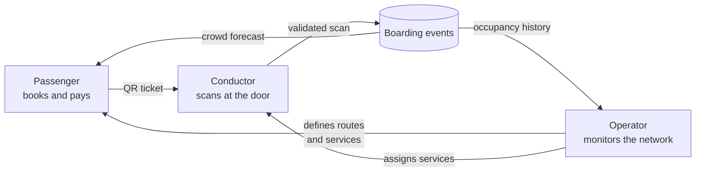

# User Journeys

Who uses this system, what each person is responsible for, and which features
belong to them.

Three people touch the product, plus one stand-in for a payment gateway. They
never share a screen: each has its own entry point, and two of them need a
passcode.

| Role | Entry point | Signs in? | Responsible for |
|---|---|---|---|
| [Passenger](./passenger.md) | `/` | No | Choosing a seat, paying, carrying the QR, boarding |
| [Conductor](./conductor.md) | `/scan` | Yes — conductor passcode | Admitting the right people, once each |
| [Operator](./operator.md) | `/admin` | Yes — admin passcode | What runs, how often, and how full it is |
| Payment provider | — | — | Accepting or declining a charge (simulated) |

## How the roles connect

The loop is the point: the conductor's scan is the only place a real boarding is
recorded, so **everything the operator sees and everything the passenger is told
about crowding comes from that one action.** No separate tracking exists.

## Where responsibilities stop

- A **passenger** cannot see other passengers, cannot see any trip's manifest,
  and cannot recover a booking without its reference.
- A **conductor** cannot create or change services, cannot see occupancy
  history, and cannot undo a validation. They choose which service they are on;
  nobody assigns it to them in the system.
- An **operator** cannot book a seat on a passenger's behalf, cannot validate a
  ticket, and cannot edit or delete boarding history — the event log rejects it
  at the database level.

## Reading order

New to the project? Read [`passenger.md`](./passenger.md) first — it is the
journey everything else exists to serve. Then
[`conductor.md`](./conductor.md), because the scan is what makes the data real.
Then [`operator.md`](./operator.md).

For the build itself, see [`TECHSTACK.md`](../../TECHSTACK.md) and the plan in
[`docs/plans/`](../plans/).
