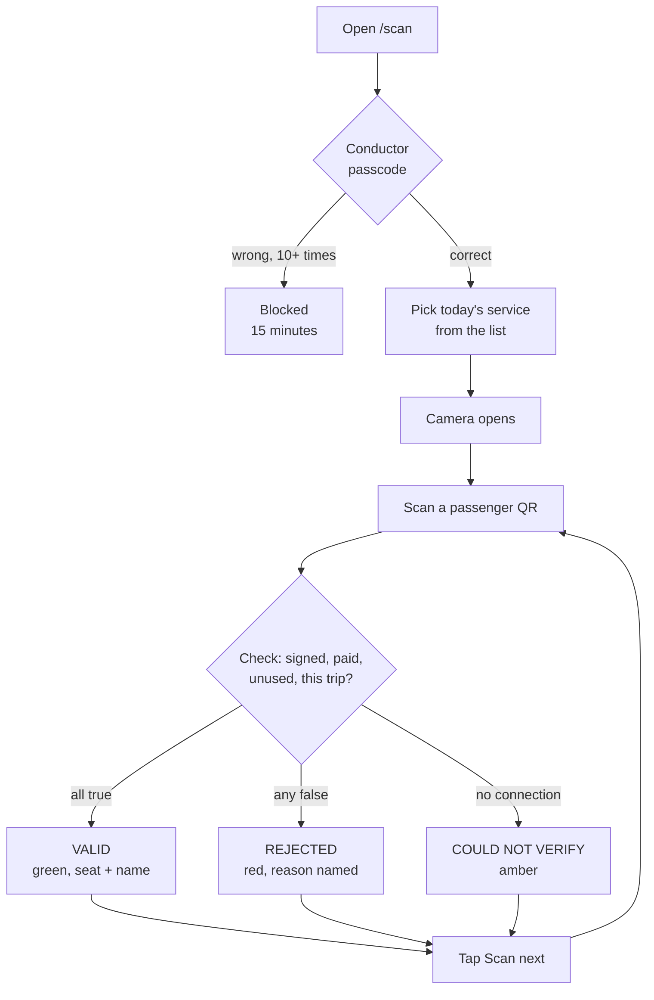

# Conductor

**Who they are:** the person at the bus door with a phone, deciding who gets on.

**What they are responsible for:** admitting exactly the people holding a valid
ticket for *this* service, and each of them exactly once.

**What they are trusted with:** consuming tickets. A validation is one-way and
cannot be undone, which is why the scanner is behind a passcode.

## The journey

## Screens

| Screen | Path | What the conductor does |
|---|---|---|
| Sign in | `/scan` | Enters the conductor passcode |
| Pick a service | `/scan` | Chooses which of today's services they are working |
| Scanner | `/scan` | Points the camera at QR codes; the selected service stays visible in the header with a "Change service" control |

## Features that belong to the conductor

**Service selection.** The conductor chooses their own service at scanner start;
nothing assigns it. The choice is held in the session and shown persistently in
the header — deliberately, because a wrong selection rejects every valid ticket,
and the header is how they notice before a queue forms.

**Three-state verdict.** Full-screen, legible at arm's length, and
distinguishable in greyscale (not colour alone):

| Verdict | Colour | Shows |
|---|---|---|
| **VALID** | green, ✓ | Seat number and passenger name |
| **REJECTED** | red, ✕ | The specific reason |
| **COULD NOT VERIFY** | amber, ? | "No connection to the server. Check signal and scan again." |

**Named rejection reasons.** Never a bare refusal:

| Reason | Detail shown |
|---|---|
| `ALREADY USED` | The time of the first scan |
| `WRONG TRIP` | Both the ticket's service *and* the scanner's selected service |
| `CANCELLED` | That the booking was cancelled |
| `NOT A VALID TICKET` | The signature did not verify |

The wrong-trip case names both services on purpose, so a conductor can tell
"this passenger is on the wrong bus" from "I picked the wrong service."

**One scan, one verdict.** A live camera decodes the same code many times per
second. Decoding pauses the moment a token is posted and the verdict holds until
"Scan next" is tapped — otherwise the very next frame would turn a green pass
into a red "already used" while the passenger is still standing there.

**Honest offline behaviour.** If the server is unreachable, the scanner says so.
It never guesses a verdict in either direction.

## What the conductor's scan produces

Every successful validation writes one immutable boarding event carrying the
trip, seat, boarding stop, alighting stop, and timestamp. **This is the only
place a real boarding enters the system.** The operator's occupancy monitor and
the passenger's crowd forecast are both computed from these rows and nothing
else.

The event log rejects row-level `UPDATE` and `DELETE` at the database level, so
a boarding record cannot be altered after the fact.

## Known gaps for this role

- **Camera on a real phone at a real door is unverified.** The decoder is
  proven in-browser, but glare, angle, screen brightness and cracked displays
  have not been tested in the field.
- **No manual fallback.** If a QR will not decode — damaged screen, dead
  battery — there is no way to admit the passenger by typing their reference.
- **No running count.** The scanner does not show how many have boarded this
  trip; that is only on the operator's manifest.
- **A validation cannot be reversed.** A mis-scan has no undo.
