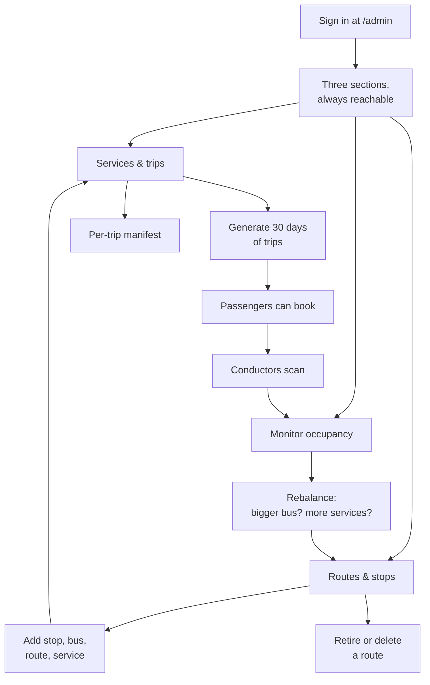

# Operator

**Who they are:** the person running the bus company — deciding what routes
exist, how often they run, and whether the service is over- or
under-provisioned.

**What they are responsible for:** the network itself (routes, stops, buses,
services), generating the trips passengers can book, and reading occupancy.

**What they are trusted with:** destructive actions. Removing a route or
resetting demo data affects everyone, so both are behind a passcode and an
explicit confirmation.

## The journey

## Screens

| Screen | Path | What the operator does |
|---|---|---|
| Services & trips | `/admin` | Sees every schedule, generates 30 days of trips per service, resets demo data |
| Routes & stops | `/admin/network` | Adds stops, buses, routes and services; retires or deletes routes |
| Monitor occupancy | `/admin/overview` | Reads load per service, a day-of-week heatmap, and the busiest segments |
| Trip manifest | `/admin/trips/[tripId]` | Sees who is on one specific trip and who has boarded |

A persistent tab bar sits on every operator page, so the three sections are
always one click apart.

## Features that belong to the operator

### Building the network

**Stops** — named localities. **Buses** — a label plus a seat layout (rows ×
column letters), which is what determines the seat map passengers see.
**Routes** — a name, a fare, and stops *in travel order*; direction matters, so
a route is only searchable from an earlier stop to a later one. **Services** — a
route paired with a bus, a departure time, and the days it runs.

Validation refuses: duplicate stops on one route, routes with fewer than two
stops, zero fares, and a bus already committed at the same time.

**Trip generation** turns a service into dated, bookable trips — 30 days at a
time, idempotent, so re-running extends the window rather than duplicating.

### Monitoring

**Headline figures** — passengers boarded, trips run, average occupancy,
services tracked.

**Occupancy by service** — average riders against capacity, a load bar, and the
fullest single trip recorded. Sorted busiest first.

**Load by day of week** — a heatmap per service. Three bands, the same ones the
passenger site uses, so operator and passenger speak one language:

| Band | Means |
|---|---|
| Under 40% | Quiet |
| 40–79% | Seats usually free |
| 80% and over | Usually busy |
| blank | Does not run that day |

**Busiest segments** — which stop-to-stop pairs carry the most passengers, taken
from each booking's origin and destination.

Every figure is counted from validated boarding scans. There is no separate
tracking system.

### Removing things safely

Every foreign key cascades, so a naive delete would destroy schedules, trips,
bookings, tickets **and the boarding history**. The operator is therefore shown
the exact impact first — "this route has 1,516 tickets and 1,519 boarding
events" — and offered two paths:

| Action | What it does | When allowed |
|---|---|---|
| **Retire** | Stops future bookings. Removes future trips with no bookings and no events; keeps everything with history, so the monitor still reports it. | Always |
| **Delete permanently** | Removes the route entirely. | Only when the route has no ticket or boarding history at all, and only after typing `DELETE` |

Removing a single service behaves the same way: unbooked future trips go,
anything with history stays, and the service simply stops running.

**Demo reset** clears all bookings, tickets and events and frees every seat,
keeping routes and schedules. Behind a typed `RESET` confirmation.

## Known gaps for this role

- **No edit.** Only add and remove. Changing a fare or renaming a route means
  recreating it.
- **The monitor is empty on day one.** It needs at least two past trips with
  scans. A fresh install shows a designed empty state rather than a zeroed
  dashboard.
- **No per-conductor view.** The system does not record which conductor scanned
  what, so there is no accountability trail.
- **No export.** Figures are on screen only; no CSV or report.
- **Occupancy counts ticketed passengers only.** Where a cash fallback exists in
  a real deployment, the numbers are a floor rather than a total.
