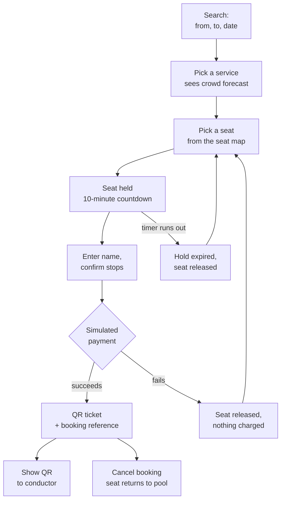

# Passenger

**Who they are:** someone who wants a seat on a bus. Not signed in, no account,
possibly on a phone at a bus stop.

**What they are responsible for:** choosing their journey and seat, paying, and
keeping hold of the ticket until they board.

**What they are trusted with:** nothing that affects anyone else. Every action
is scoped to their own booking.

## The journey

## Screens and what each one does

| Screen | Path | What the passenger does |
|---|---|---|
| Search | `/` | Sees today's departures listed by default. Picks boarding stop, destination, date to narrow. The destination list only offers stops reachable from the chosen origin, so a search cannot be a dead end. |
| Seat map | `/trips/[tripId]` | Sees the bus laid out with the aisle, picks one available seat. Held and booked seats are disabled. |
| Details and payment | `/book/[holdId]` | Enters their name, confirms boarding and alighting stops, pays. A countdown shows how long the seat is held. |
| Ticket | `/booking/[ref]` | Sees the QR, seat, fare, status, and the booking reference. Can cancel while unused. |
| Find a booking | `/find` | Types a reference to bring the ticket back. |

## Features that belong to the passenger

**Today's departures, with no search.** The landing page lists services
departing today — route, journey, stop count, fare and seats free — each
bookable in one click.

**Reachable destinations only.** Picking a boarding stop narrows the destination
list to stops that are actually served onward from it, and says how many. Before
this, most of the 650 possible stop pairs returned "nothing runs this journey".

**Crowd forecast.** Each service in the search results shows how full it usually
is — "Usually quiet", "Seats usually free", or "Usually busy", with an expected
percentage. Averaged from past boardings on the *same service and same weekday*.
It appears only once at least two comparable trips have history; a brand-new
service shows nothing rather than guessing.

**Seat selection with a real hold.** Picking a seat reserves it for 10 minutes
(configurable via `HOLD_DURATION_MINUTES`). Nobody else can take it during that
window. The countdown is driven by the server's expiry time, not the browser
clock. If it lapses, the seat returns to the pool and the passenger is told —
they never reach payment on a dead hold.

**Simulated payment.** The flow is real; the charge is not. A "Force this
payment to fail" checkbox exists for demonstrating the failure path. A failure
releases the seat and charges nothing.

**The QR ticket.** An opaque signed token, not booking data — a forged code
cannot assert its own validity. Shown on screen; the conductor scans it.

**Booking reference.** Ten characters of Crockford base32 from a secure random
source. This is the *only* way back to a ticket, since there are no accounts.

**Cancellation.** While unused, a passenger can cancel. The seat returns to
inventory and the QR stops validating immediately.

## What can go wrong, and what they see

| Situation | What happens |
|---|---|
| Someone takes the seat first | "Seat 12A was taken while you were choosing. Pick another." |
| Hold expires mid-form | Countdown hits zero, pay button disables, offered a route back to the seat map |
| Payment declines | "Payment failed and your hold was released. Pick a seat again." |
| Reference not found | Not-found, without revealing whether it ever existed |
| Ticket already scanned | The ticket page shows "Boarded at 08:04" instead of the QR |
| Ticket cancelled | Shows "Cancelled"; the QR is gone |

## Known gaps for this role

- **Lose the reference and the ticket is unrecoverable.** No email, no SMS, no
  wallet pass, no download. A WhatsApp delivery channel is the recorded
  candidate for fixing this.
- **The QR is screen-only.** No connectivity at the door means no ticket, since
  the ticket page is server-rendered.
- **No booking history.** Without accounts, past trips are not listed anywhere
  the passenger can reach.
